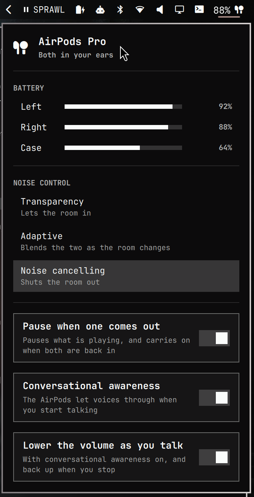

# AirPods for the Omarchy bar

Battery, noise control and in-ear pause for AirPods, as a bar widget.

- **Bar:** an AirPods icon with the battery of the lower AirPod. It dims when
  none are connected. Scroll on it to step through the noise control modes.
- **Panel:** battery of each AirPod and the case, the noise control mode
  (Transparency, Adaptive, Noise cancelling, and Off where the AirPods allow
  it), and three switches:
  - pause what is playing when an AirPod comes out, and carry on when both
    are back in
  - conversational awareness on the AirPods
  - lower the computer's volume while you talk

Pair and connect the AirPods from the Bluetooth panel as usual. The widget
finds them once they are connected.

## How it works

`airpods` is a Python script that speaks Apple's accessory protocol to the
AirPods over Bluetooth, the way an iPhone does. It needs no root and nothing
beyond what Omarchy ships (Python with `dbus` and `gi`, BlueZ, WirePlumber).
The protocol notes come from [LibrePods](https://github.com/kavishdevar/librepods).

    airpods status                                  what the AirPods report
    airpods mode <off|transparency|adaptive|anc>    switch the noise control mode

The two computer-side switches are saved in
`~/.local/state/omarchy/airpods.json`.

## Install

    git clone https://github.com/ben-chitin/airpods-omarchy ~/.config/omarchy/plugins/bhj.airpods
    omarchy plugin enable bhj.airpods

Developed against AirPods Pro 2 on an M1 MacBook Air. Other models that speak
the same protocol should report battery and in-ear state.
